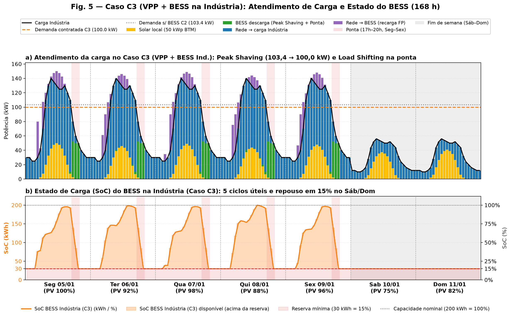
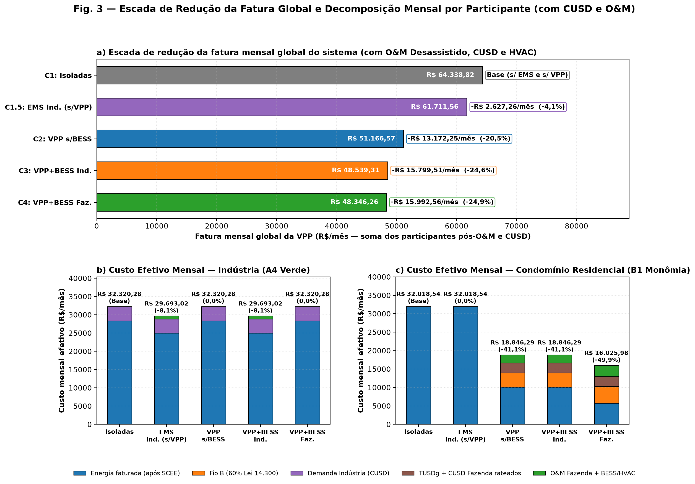
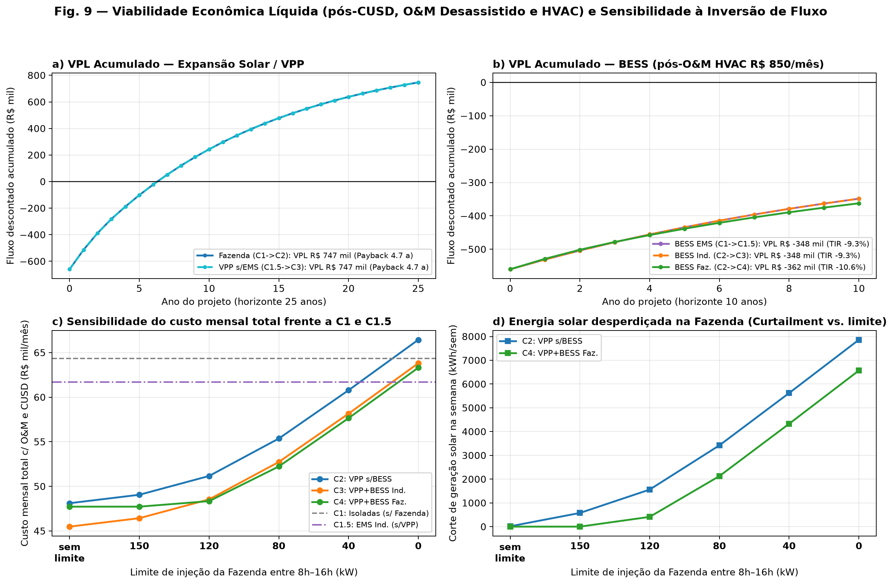
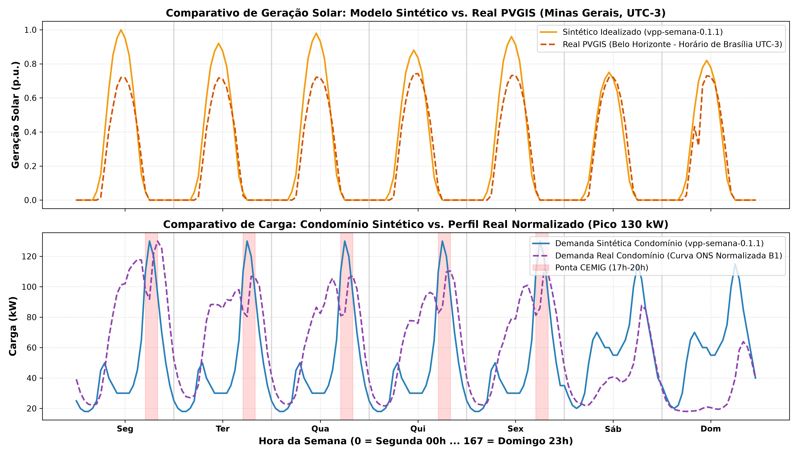

# Virtual Power Plant (VPP) & EMS Dispatch Optimizer

[](https://www.python.org/downloads/)
[](https://pypsa.org/)
[](https://linopy.readthedocs.io/)
[](https://highs.dev/)
[](http://www.planalto.gov.br/ccivil_03/_ato2019-2022/2022/lei/l14300.htm)
[]()

Motor de otimização matemática e despacho horário de **Microrredes e Usinas Virtuais (Virtual Power Plants - VPP)** no contexto regulatório e tarifário brasileiro (**Lei 14.300/2022**, **REN 1.000/2021 da ANEEL** e estrutura tarifária da **CEMIG-D**).

Formulado em **Programação Linear Inteira Mista (MILP)** para modelar com exatidão física e financeira o acoplamento temporal de baterias (BESS), geração solar local e remota, restrições operacionais de injeção na rede (*curtailment*) e a regra contábil do Sistema de Compensação de Energia Elétrica (SCEE).

---

## 🏛️ Arquitetura do Repositório

```text
vpp-dispatch-optimizer/
│
├── data/                                   # Datasets de entrada e resultados horários
│   ├── perfis_reais_exemplo_168h.csv       # Curvas horárias reais (PVGIS BH/MG + ONS Sudeste 2026)
│   ├── setpoints_ems_semana_011.json       # Despacho ótimo horário exportado para EMS
│   └── vpp_semana_011_operacao_horaria.csv # Matriz horária consolidada de potências (168 h)
│
├── figures/                                # Resultados visuais e diagnósticos de alta resolução
│   ├── vpp_semana_011_fig1_perfis.png
│   ├── vpp_semana_011_fig2_c15_ems_isolado.png
│   ├── vpp_semana_011_fig3_escada_fatura_participantes.png
│   ├── vpp_semana_011_fig4_c2_vpp_sem_bess.png
│   ├── vpp_semana_011_fig5_c3_vpp_bess_ind.png
│   ├── vpp_semana_011_fig6_c4_vpp_bess_faz.png
│   ├── vpp_semana_011_fig7_fazenda_operacao.png
│   ├── vpp_semana_011_fig8_fazenda_diario_corte.png
│   ├── vpp_semana_011_fig9_economica_sensibilidade.png
│   ├── analise_rateio_vpp.png              # Curva de sensibilidade do rateio ótimo (0% a 100%)
│   └── comparativo_perfis_reais_vs_sinteticos.png
│
├── src/                                    # Código-fonte modularizado
│   ├── __init__.py
│   ├── config.py                           # Parâmetros regulatórios, tarifários, técnicos e temporais
│   ├── data_loader.py                      # Processamento de curvas sintéticas e reais
│   ├── model.py                            # Formulação MILP na rede PyPSA com restrições Linopy
│   ├── audit.py                            # Auditoria contábil independente e conciliação do solver
│   └── economics.py                        # Fluxo de caixa descontado plurianual (VPL, TIR, Payback)
│
├── .gitignore                              # Exclusão de arquivos de cache e ambiente virtual
├── main.py                                 # Interface de linha de comando (CLI) executável
├── requirements.txt                        # Dependências do ambiente Python
└── README.md                               # Documentação técnica e operacional
```

---

## ⚖️ Conformidade Regulatória (Lei 14.300/2022 e REN 1.000/2021)

O otimizador implementa rigorosamente os seguintes pilares regulatórios brasileiros:

1. **Prioridade Zero de Autoconsumo Local:**  
   A geração da Fazenda Solar supre primeiro a sua própria carga auxiliar contínua ($1{,}20\text{ kW}$ base $+ 1{,}20\text{ kW}$ pico de ventilação). O Fio B da usina incide estritamente sobre a energia compensada localmente (`comp_f = min(imp_faz, inj_bruta)`), e apenas o excedente líquido restante (`inj_liq = inj_bruta - comp_f`) é enviado para rateio remoto.
2. **Valoração de Créditos no Grupo B1 por Posto (Art. 655-G §5 da REN 1.000):**  
   Os créditos gerados em alta tensão (A4 Verde) são convertidos para o consumidor residencial em baixa tensão (B1 Convencional) pela razão das Tarifas de Energia homologadas ($\text{TE}_{\text{A4}}/\text{TE}_{\text{B1}}$):
   * Posto Ponta: $k_{\text{P}} = 0{,}47 / 0{,}35 = 1{,}3429$
   * Posto Fora de Ponta: $k_{\text{FP}} = 0{,}29 / 0{,}35 = 0{,}8286$
3. **Compensação Cruzada com Trava de Ordem (Grupo A4):**  
   A compensação entre postos horossazonais (Ponta e Fora de Ponta) ocorre apenas quando a compensação no mesmo posto é esgotada, respeitando a equivalência tarifária com variáveis binárias e Big-M calibrado ($M_{\text{BIG}} \approx 10.750\text{ kWh}$).
4. **Curva de Transição do Fio B (Art. 27 da Lei 14.300):**  
   Progressão anual do Fio B (60% em 2026, 75% em 2027, 90% em 2028 e 100% pós-2028) aplicada na modelagem do fluxo de caixa de 25 anos.
5. **Restrição de Inversão de Fluxo (Art. 73 da REN 1.000/2021):**  
   Limite de injeção na subestação imposto pela concessionária ($120\text{ kW}$ entre 08h e 16h), gerando corte de geração (*curtailment*) a menos que haja armazenamento local (BESS).

---

## 📊 Cenários Analisados

| Cenário | Descrição | Configuração Física | Objetivo Operacional |
| :--- | :--- | :--- | :--- |
| **C1** | **Consumidores Isolados** | Indústria (50 kWp solar) e Condomínio (100 aptos) | Referência *Baseline* sem cooperação. |
| **C1.5** | **EMS Industrial Local** | Indústria com BESS (50 kW / 200 kWh) | *Peak shaving* (demanda contratada de 110 para 99,5 kW) e arbitragem de ponta (17h-20h). |
| **C2** | **VPP sem BESS** | Adição de Fazenda Solar (200 kWp remota) | Compensação remota sob rateio ótimo global (100% Condomínio). |
| **C3** | **VPP + BESS na Indústria** | Fazenda Solar remota + BESS na fábrica | Sinergia de compensação remota com gestão local de demanda. |
| **C4** | **VPP + BESS na Fazenda** | Fazenda Solar remota + BESS na usina | Absorção do *curtailment* de injeção diurna e injeção tardia. |

### 📸 Operação Integrada em Modo VPP (Cenário C3)


---

## 📈 Principais Resultados Econômicos (Versão 0.1.1)

### Faturamento Mensal Consolidado (Projeção: 30,44 dias/mês)

```
======================================================================================
Cenário | Descrição            | Fatura Total     | Indústria     | Condomínio    | Economia vs C1
--------------------------------------------------------------------------------------
C1     | Isoladas             | R$    64,338.82 | R$ 32,320.28 | R$ 32,018.54 | R$      0.00 (- 0.0%)
C1.5   | EMS Ind. (s/VPP)     | R$    60,861.56 | R$ 28,843.02 | R$ 32,018.54 | R$  3,477.26 (- 5.4%)
C2     | VPP s/BESS           | R$    48,966.57 | R$ 32,320.28 | R$ 13,931.64 | R$ 15,372.25 (-23.9%)
C3     | VPP+BESS Ind.        | R$    45,489.31 | R$ 28,843.02 | R$ 13,931.64 | R$ 18,849.51 (-29.3%)
C4     | VPP+BESS Faz.        | R$    45,296.26 | R$ 32,320.28 | R$ 10,302.90 | R$ 19,042.56 (-29.6%)
======================================================================================
```

### 💰 Redução de Fatura por Participante da VPP


---

### Análise de Viabilidade Plurianual de Investimento (WACC Real: 8% a.a.)

```
======================================================================================
Ativo / Transição        | CAPEX (R$)    | VPL (R$)       | TIR (%)   | Payback
--------------------------------------------------------------------------------------
Fazenda Solar (C1->C2)   | R$    660,000 | R$     746,773 |     20.4% | 4.7 anos
VPP sob EMS (C1.5->C3)   | R$    660,000 | R$     746,773 |     20.4% | 4.7 anos
BESS EMS (C1->C1.5)      | R$    560,000 | R$    -348,451 |     -9.3% | Não amortiza
BESS Ind. (C2->C3)       | R$    560,000 | R$    -348,451 |     -9.3% | Não amortiza
BESS Faz. (C2->C4)       | R$    560,000 | R$    -362,274 |    -10.6% | Não amortiza
======================================================================================
```

> **Conclusão Estratégica:** A Fazenda Solar é um investimento de excelente retorno (**Payback de 4,7 anos e TIR de 20,4%**). Os sistemas BESS, nos custos de CAPEX atuais (R$ 2.800/kWh), ainda não se pagam puramente por arbitragem tarifária, demandando incentivos regulatórios para serviços ancilares ou queda futura no custo das baterias.

### 📉 Análise de Sensibilidade e Ponto de Equilíbrio do BESS


---

## 🚀 Como Executar

### 1. Clonar e Instalar Dependências

```bash
git clone https://github.com/marvel-dv/vpp-dispatch-Brazil.git
cd vpp-dispatch-Brazil
pip install -r requirements.txt
```

### 2. Executar em Modo Padrão (Perfis Sintéticos)

```bash
python main.py
```

### 3. Executar com Dados Reais de Satélite e Medição (PVGIS / ONS)

O repositório já inclui a planilha `data/perfis_reais_exemplo_168h.csv` com dados horários reais de Belo Horizonte (MG) e demanda do Sudeste brasileiro:

```bash
python main.py --real-data
```



---

## 🛠️ Tecnologias e Metodologia

* **Linguagem:** Python 3.10+
* **Modelagem:** [PyPSA](https://pypsa.org/) (Python for Power System Analysis)
* **Formulação Simbólica:** [Linopy](https://linopy.readthedocs.io/)
* **Solver Matemático:** [HiGHS](https://highs.dev/) (Branch-and-Bound / Simplex)
* **Auditoria Contábil:** Rotina independente com tolerância estrita ($\Delta < 0{,}01\text{ R\$}$).
* **Dados Reais:** [PVGIS API](https://re.jrc.ec.europa.eu/pvg_tools/en/) e [Portal de Dados Abertos do ONS](https://dados.ons.org.br/).

---

## 📄 Licença
Distribuído sob licença MIT. Desenvolvido para pesquisa acadêmica e aplicações práticas no setor elétrico brasileiro.
